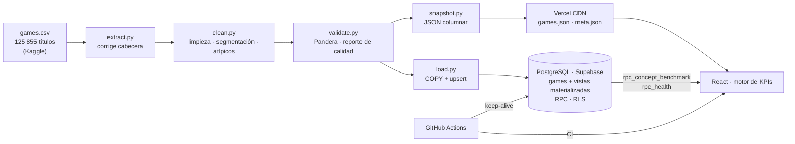
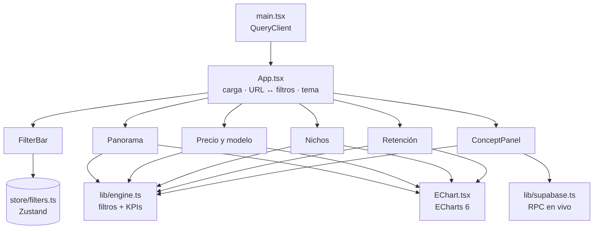

# Arquitectura

## Flujo de datos

## Front

| Capa | Archivo | Responsabilidad |
|---|---|---|
| Datos | `lib/dataSource.ts` | Carga del snapshot y conversión a arreglos tipados |
| Cálculo | `lib/engine.ts`, `lib/stats.ts` | Filtros y KPIs con las mismas fórmulas que el SQL |
| Estado | `store/filters.ts` | Filtros globales, vista activa y sincronización con la URL |
| En vivo | `lib/supabase.ts` | Cliente de solo lectura, `rpc_concept_benchmark`, `rpc_health` |
| Visual | `components/`, `features/` | Controles accesibles, tarjetas con vista de tabla, vistas |
